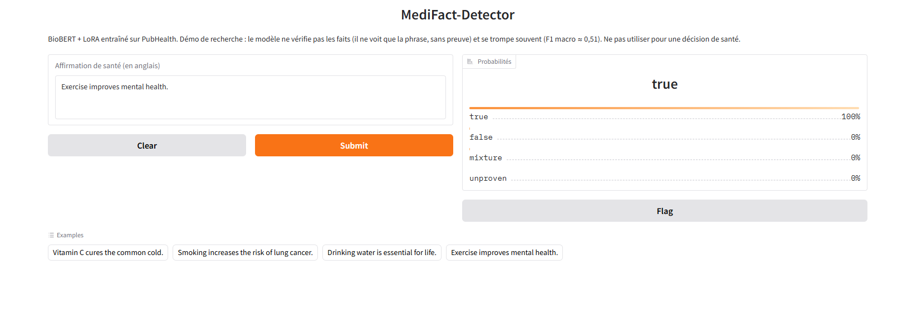

# MediFact-Detector

Detection of **health misinformation** from short claims, by **fine-tuning Transformer encoders** ...

## Demo

<p align="center">
  
</p>

*Gradio demo: BioBERT + LoRA predicts a verdict and class probabilities for a health claim. Research demo, not medical advice.*

## 1. Why this project?

### Why detect health misinformation?
False medical claims ("this remedy cures everything", "this vaccine causes X") spread fast and can have real consequences: delayed care, dangerous self-medication, loss of trust. Checking every claim manually is impossible at scale.

### What MediFact-Detector does
For a given claim, the model predicts one of 4 verdicts:

| Class | Meaning |
|---|---|
| `true` | The claim is true |
| `false` | The claim is false |
| `mixture` | Partly true / nuanced |
| `unproven` | Not scientifically proven |

### Scientific and practical value
- **Research question**: can we get close to full fine-tuning performance while training **less than 1 % of the parameters** (LoRA)?
- **Engineering value**: less GPU memory, faster training, lightweight adapters to store, which matters on a modest GPU (here an RTX 4050, 6 GB).
- **Rigorous comparison** of 6 approaches: TF-IDF, zero-shot LLM, BERT/BioBERT with full fine-tuning, BERT/BioBERT with LoRA.
- **Explainability** (SHAP): understand *which words* push the model toward a verdict.
- Interactive **demo** (Gradio).

---

## 2. Key concepts

### 2.1 Fine-tuning

> **Analogy**: a general practitioner (a model pre-trained on lots of text) who specializes in cardiology (fine-tuning on your task). You don't teach them to read again; you sharpen their skills.

```
Pre-training (huge corpus, expensive)  →  Fine-tuning (small labeled dataset, your task)
   "understands language"                    "detects health misinformation"
```

- **Full fine-tuning**: **all** weights are updated (~110 M for BERT). Powerful but costly in memory and time.
- **PEFT**: only a **very small fraction** of the parameters is updated.

### 2.2 PEFT: *Parameter-Efficient Fine-Tuning*

A family of methods that adapt a large model by training very few parameters, while the base model stays **frozen**.

| Method | Principle | Analogy |
|---|---|---|
| **LoRA** | Adds small **low-rank** matrices alongside existing weights | Sticky notes with corrections on a textbook |
| **QLoRA** | LoRA + **quantized** (4-bit) base model → even less memory | The same textbook, printed in compact format |
| **Adapters** | Inserts small modules (layers) between Transformer layers | Dividers added between chapters |
| **Prefix / Prompt tuning** | Learns "virtual" vectors added to the input or to the layers | A secret instruction learned and slipped before every question |
| **IA³** | Learns *scaling* vectors that amplify or damp activations | Volume knobs on some connections |
| **BitFit** | Trains only the **biases** | Adjusting only the fine-tuning knobs |

### 2.3 LoRA: *Low-Rank Adaptation*

#### Principle
A weight matrix `W` (large, e.g. 768×768) is **frozen**. Instead, we learn a **low-rank** update:

```
        W' = W  +  ΔW      with   ΔW = B · A

  W  : d × d   (frozen)          A : r × d     B : d × r      r << d  (e.g. r = 16)

  input x ──┬──────────────► W ───────────────┐
            │                                  ⊕ ──► output
            └──► A ──► B ──► (× alpha/r) ──────┘
                 (trainable)
```

Instead of training `d × d` parameters, we train `2 × d × r`.
Example: d = 768, r = 16 → 589,824 parameters → **24,576** (≈ 24× fewer).

#### Main hyperparameters
| Parameter | Role |
|---|---|
| `r` (rank) | Adapter capacity (larger = more expressive, heavier) |
| `lora_alpha` | Scaling factor of the update (`alpha / r`) |
| `target_modules` | Targeted layers (e.g. attention `query`, `value`) |
| `lora_dropout` | Regularization |

#### Why use LoRA?
- **Memory**: far fewer gradients and optimizer states to store.
- **Speed**: lighter training.
- **Storage**: the adapter weighs a few MB (instead of hundreds).
- **Modularity**: one base model, several adapters (one per task).
- **Less catastrophic forgetting**: the base model stays untouched.
- **Limit**: on a small task, the gap with full fine-tuning can be small or null; hyperparameters (higher learning rate, more epochs) must be adapted.

### 2.4 Encoders, decoders, and the difference between them

Both are Transformers, but they **don't read text the same way**.

```
ENCODER (BERT)                          DECODER (GPT, Llama, Mistral)
BIDIRECTIONAL attention                 CAUSAL attention (left → right)

 The patient takes some [?]             The patient takes some →  ?
  ↔     ↔      ↔     ↔                   →     →       →     →
 every word sees ALL the context        every word sees only the PAST
```

| Criterion | **Encoder** | **Decoder** |
|---|---|---|
| Examples | BERT, BioBERT, RoBERTa, CamemBERT | GPT, Llama, Mistral, Claude |
| Attention | Bidirectional (left **and** right) | Causal (left only) |
| Pre-training | *Masked Language Modeling* (guess a masked word) | *Next-token prediction* (guess the next word) |
| Typical output | A **representation** (vector) of the text | **Generated** text |
| Strengths | Classification, NER, similarity, search | Generation, dialogue, reasoning, few-shot |
| Typical size | Small to medium (~100 M–400 M) | Medium to very large (7 B → hundreds of B) |
| Inference cost | Low | High |

> **Analogy**: the encoder is a **reader** who has read the whole page before answering; the decoder is a **writer** who composes word by word without knowing what comes next.

*(There are also **encoder-decoder** models such as T5 or BART, used for translation and summarization.)*

#### Why an encoder for this project?
The task is **short-text classification**: the model must *understand* the claim, not generate one. A ~110 M-parameter encoder is:
- **lighter** and faster than an LLM,
- **better suited** to supervised classification,
- **fine-tunable** on a 6 GB GPU.

Our results confirm it: the zero-shot LLM (macro-F1 0.27) is far below the fine-tuned encoders (~0.50).

### 2.5 BERT vs BioBERT
- **BERT**: pre-trained on general text (Wikipedia, books).
- **BioBERT**: BERT further trained on biomedical corpora (PubMed, PMC) → better vocabulary and domain knowledge.

---

## 3. State of the art

### 3.1 Health claim verification: datasets
| Dataset | Focus | Note |
|---|---|---|
| **PubHealth** (Kotonya & Toni, 2020) | Public-health claims from fact-checking sites and news, 4 labels | Used here (≈ 11.8 k claims) |
| **SciFact** (Wadden et al., 2020) | Scientific claims checked against paper abstracts | Evidence-based, 3 labels |
| **HealthVer** (Sarrouti et al., 2021) | COVID-19 claims verified against scientific evidence | Evidence-based |
| **COVID-Fact** (Saakyan et al., 2021) | COVID-19 claims with retrieved evidence | Includes generated refuted claims |

### 3.2 Model families
| Family | Examples | Role in the field | In this project |
|---|---|---|---|
| **General encoders** | BERT, RoBERTa | Strong supervised baselines | Yes (BERT) |
| **Biomedical encoders** | SciBERT, **BioBERT**, PubMedBERT, BioLinkBERT | Domain pre-training on PubMed / PMC, often better on biomedical tasks | Yes (BioBERT) |
| **LLMs (zero/few-shot)** | GPT, Llama, Mistral, Claude | Flexible, no training, but prone to label bias and costly | Yes (zero-shot baseline) |
| **Retrieve-then-verify pipelines** | RAG + LLM / NLI verifier | Ground the verdict in retrieved evidence, a major research direction | Future work |

### 3.3 Parameter-efficient fine-tuning
| Year | Method | Idea |
|---|---|---|
| 2019 | **Adapters** (Houlsby et al.) | Small modules inserted between layers |
| 2021 | **Prefix / Prompt tuning** (Li & Liang; Lester et al.) | Learned virtual prompts |
| 2021 | **LoRA** (Hu et al.) | Low-rank weight updates, **used here** |
| 2022 | **IA³** (Liu et al.) | Learned scaling vectors |
| 2023 | **QLoRA** (Dettmers et al.) | LoRA on a 4-bit quantized base model |
| 2023–24 | **AdaLoRA**, **DoRA** | Adaptive rank allocation / weight-decomposed LoRA |

### 3.4 Positioning
MediFact-Detector sits at the crossroads of these lines: it compares a **general vs a biomedical encoder** and **full fine-tuning vs LoRA** on a public health-claim dataset, under a **multi-seed protocol with confidence intervals**, a level of statistical rigor that is often missing in single-run comparisons.

---

## 4. Data and methodology

- **Dataset**: PubHealth (`bigbio/pubhealth`, config `pubhealth_bigbio_pairs`), train / validation / test splits (test = 1,231 examples).
- **Class distribution**: `true` 51.8 % · `false` 30.6 % · `mixture` 14.6 % · `unproven` 3.0 % → **strong imbalance**, hence `class_weights` and **macro-F1**.
- **Cleaning**: corrupted rows (badly escaped CSV) removed, triple-quote noise fixed (`clean_claim_text()`).
- **Tokenization**: `MAX_LENGTH = 64` (≈ 0.7 % of claims truncated).
- **Training pipeline**: fixed seed, 10 % warmup, early stopping, best checkpoint selected on validation macro-F1.
- **Multi-seed protocol**: 3 seeds (42, 43, 44) × 4 configurations, mean ± standard deviation, then **95 % bootstrap CI**.

---

## 5. Results

### Comparison of approaches (test macro-F1)

| Approach | Macro-F1 | Note |
|---|---|---|
| Zero-shot LLM (Groq / allam-2-7b) | 0.267 | Over-predicts `unproven` (43.6 % of cases) |
| TF-IDF + Logistic Regression | 0.447 | Classic baseline |
| **BERT** full fine-tuning | 0.502 ± 0.010 | 859 s · 2.37 GB |
| **BERT + LoRA** | 0.504 ± 0.005 | 588 s · 0.74 GB · 0.54 % params |
| **BioBERT** full fine-tuning | 0.496 ± 0.007 | 752 s · 2.19 GB |
| **BioBERT + LoRA** | **0.513 ± 0.010** | 543 s · 0.73 GB · 0.54 % params |

*(mean ± standard deviation over 3 seeds)*

### An honest reading of the results
- Fine-tuned encoders **clearly outperform** the baselines (TF-IDF and zero-shot LLM).
- **LoRA matches full fine-tuning** with **< 1 % of the parameters**, about **3× less GPU memory** and faster training.
- The **95 % bootstrap CIs overlap**: LoRA vs full and BioBERT vs BERT differences are **statistically inconclusive** (largest: BioBERT LoRA − BioBERT full = +0.017 [−0.006; +0.042]). We can conclude **practical equivalence**, not LoRA superiority.
- The minority class `unproven` remains **the hardest** (F1 ≈ 0.21–0.28 on average).

### Final model
**BioBERT + LoRA (seed 42)**, saved in `models/biobert_lora`: test macro-F1 = 0.524, 95 % CI [0.487; 0.561].
This score is above the 3-seed mean (0.513): the reference value for comparison remains the **multi-seed mean**.

## 6. Limitations

- **Modest-sized** and **imbalanced** dataset (few `unproven` examples).
- Non-negligible variability across seeds; differences between configurations stay within the uncertainty intervals.
- The zero-shot LLM was tested with a single model (allam-2-7b): it does not represent maximum LLM performance.
- The model **does not replace** verification against reliable sources: it is a support tool, not a medical authority.

---

## 7. EU AI Act considerations

*Informational summary, **not legal advice**. Regulation (EU) 2024/1689; the dates below reflect the 2026 "AI Omnibus" amendments and should be re-checked before any deployment.*

| Topic | What it means for MediFact-Detector |
|---|---|
| **Scope / research** | The Act exempts AI developed solely for scientific research, and R&D activities before a system is placed on the market. The current project (academic experiments) falls in this zone. |
| **Risk level** | A claim-classification tool for general information is **not** listed as high-risk by default. It would become high-risk if embedded in a **medical device** or used for decisions in an Annex III area. |
| **High-risk deadlines** | Postponed by the Omnibus: Annex III systems to **2 Dec 2027**, product-embedded systems (e.g. medical devices) to **2 Aug 2028**. |
| **Transparency (Art. 50)** | In force since **2 Aug 2026**: users must be told they are interacting with an AI system. The **Gradio demo** should display a clear notice such as "AI-generated verdict, not medical advice". |
| **AI literacy (Art. 4)** | Organisations deploying AI must take measures to support AI literacy of their staff. |
| **Data** | PubHealth contains public claims, no personal data intended; re-check licensing before any redistribution or commercial use. |

**Checklist before going public**
- [ ] Add an "AI-generated, not medical advice" banner in `app/app.py`
- [ ] Document training data, metrics, and known limits (see sections 5 and 6)
- [ ] Do not market the tool as a diagnostic or medical device
- [ ] Re-verify AI Act dates and your risk classification

Sources: [Goodwin, AI Act transparency obligations now in force](https://www.goodwinlaw.com/en/insights/publications/2026/08/alerts-technology-dpc-eu-ai-act-transparency-obligations-now-in-force) · [Gibson Dunn, AI Act Omnibus agreement](https://www.gibsondunn.com/eu-ai-act-omnibus-agreement-postponed-high-risk-deadlines-and-other-key-changes/)

---

## 8. Future work
- Handle imbalance differently (focal loss, oversampling `unproven`).
- Compare other biomedical encoders (PubMedBERT, BioLinkBERT) and a decoder fine-tuned with LoRA.

---

##  References
- Devlin et al., *BERT: Pre-training of Deep Bidirectional Transformers* (2018)
- Lee et al., *BioBERT: a pre-trained biomedical language representation model* (2019)
- Hu et al., *LoRA: Low-Rank Adaptation of Large Language Models* (2021)
- Dettmers et al., *QLoRA: Efficient Finetuning of Quantized LLMs* (2023)
- Kotonya & Toni, *Explainable Automated Fact-Checking for Public Health Claims* (PubHealth, 2020)
- **PEFT** library: https://github.com/huggingface/peft
- **AI assistance**: Claude (Anthropic) was used as an assistant for debugging, refactoring, learning support and documentation. The author ran all experiments and is responsible for the results.
